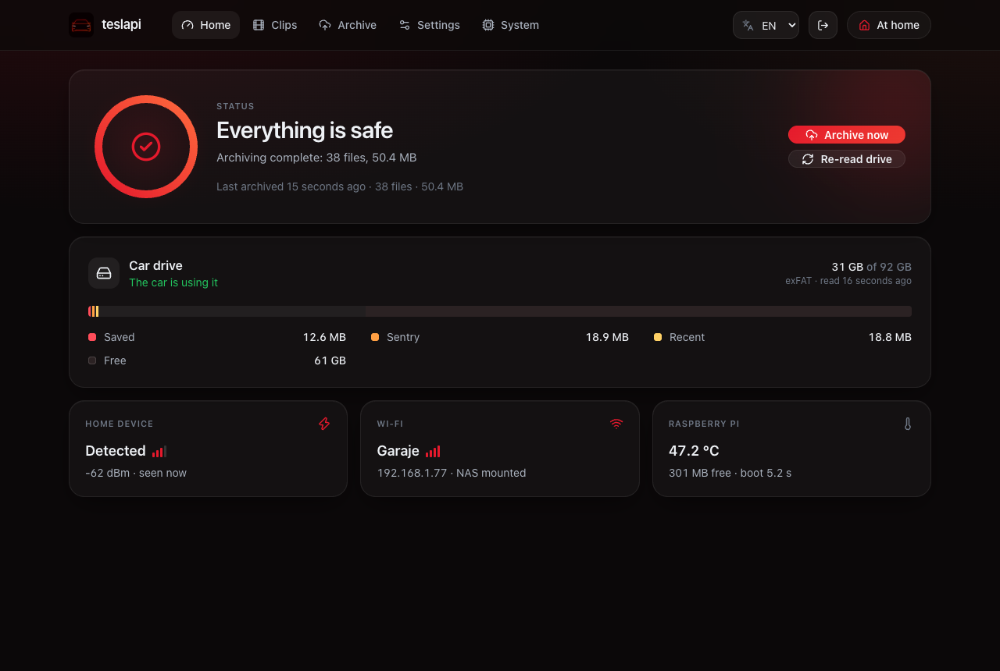
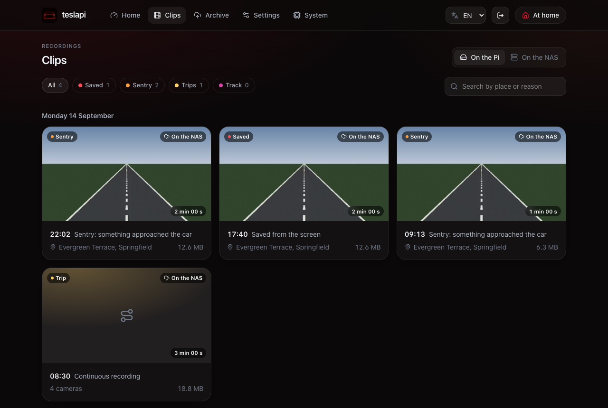
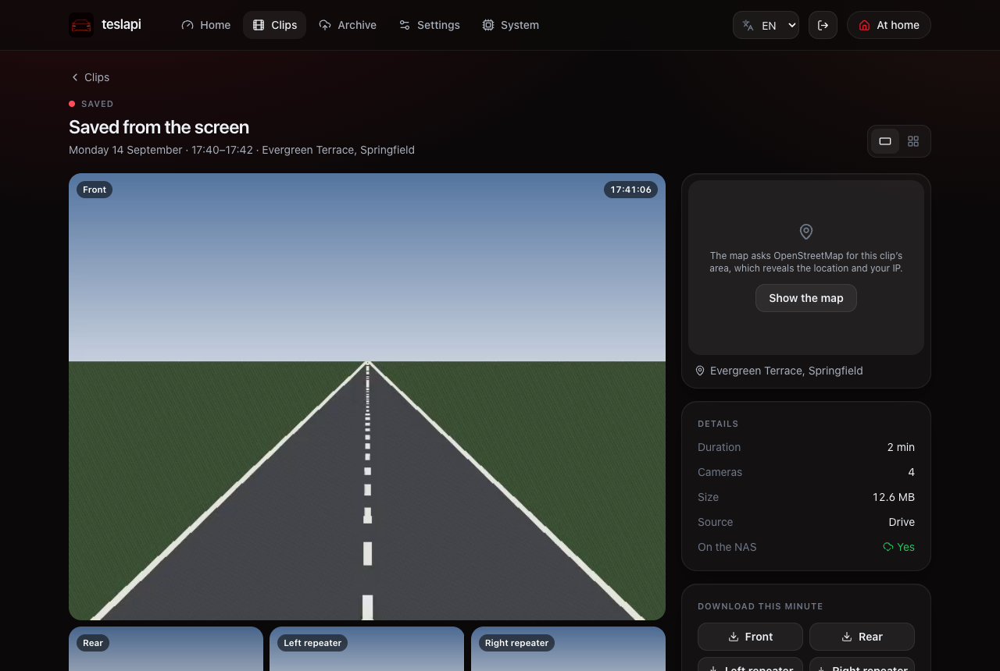
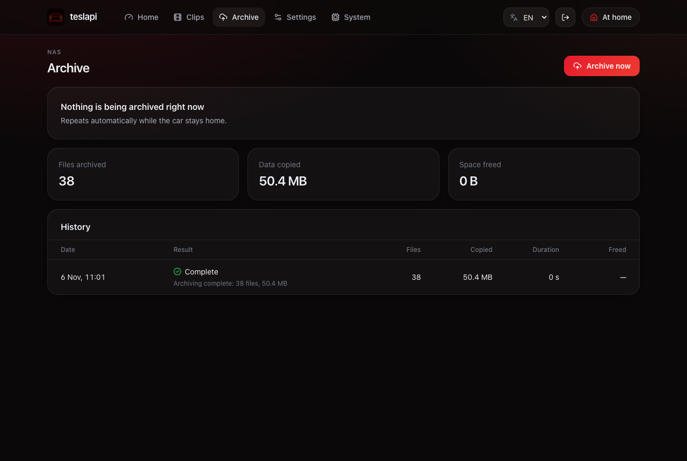
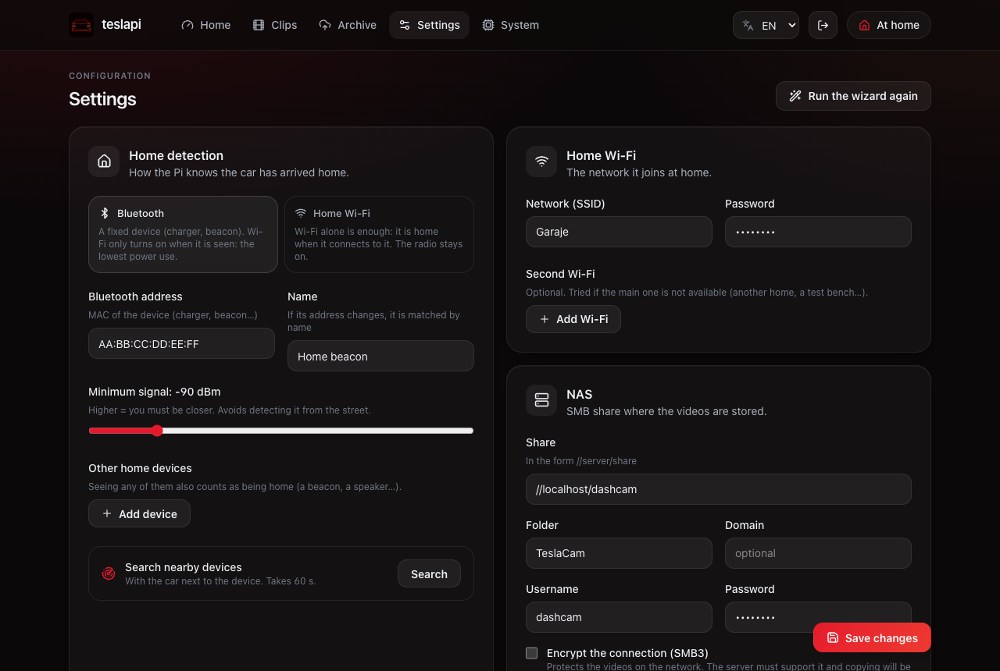
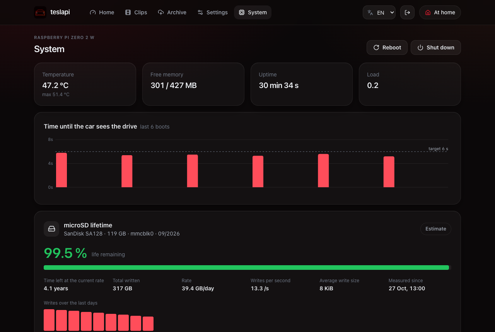
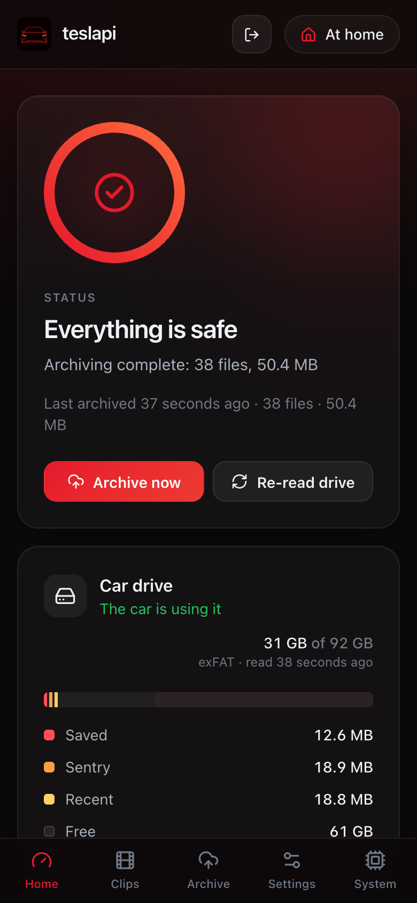

# teslapi

[English](README.md)

Pendrive inteligente para la dashcam del Tesla en una **Raspberry Pi Zero 2 W**. El coche lo ve como un
USB normal donde graba la dashcam y el Centinela, y puede formatearlo cuando quiera. Cuando la Pi ve
un dispositivo Bluetooth fijo de casa (el cargador, una baliza), enciende la Wi-Fi, copia los vídeos
a tu NAS por SMB y se ven en un portal web en tu red.

> Proyecto independiente, sin relación con Tesla, Inc. ni respaldo suyo. «Tesla» es una marca de su
> titular. Una dashcam graba a otras personas y cada país lo regula distinto: usarla conforme a la ley
> es responsabilidad tuya.

## Capturas



| | |
|---|---|
|  |  |
| **Clips** por día, de la Pi o del NAS | **Visor** con las cuatro cámaras sincronizadas |
|  |  |
| **Archivado**: totales e historial | **Ajustes** de detección de casa, Wi-Fi y NAS |
|  |  |
| **Sistema**: salud, arranque y vida de la microSD | También funciona en el **móvil** |

Las capturas muestran el portal en inglés con datos de demostración: los clips son sintéticos, y los nombres de lugar, red y dispositivo son inventados.

## Cómo funciona

```
Coche ──USB──▶ configfs mass_storage ──▶ /data/cam_disk.bin (exFAT, lo gestiona el coche)
                                               │ cp --reflink (instantáneo, sin desconectar el USB)
                                               ▼
                         /data/snap/*.bin ─ fsck de la copia ─ mount ro ─▶ CIFS ─▶ NAS/TeslaCam
BLE (BlueZ) ─ presencia del dispositivo de casa con histéresis ─▶ Wi-Fi on/off (NetworkManager + rfkill)
teslapid (Go, un binario) ─ API + portal Svelte embebido
```

- **El coche puede formatear sin romper nada.** Solo ve `cam_disk.bin`; el sistema y `/data` nunca se
  exponen. Cada lectura detecta de nuevo la tabla de particiones (MBR, GPT o ninguna) y el sistema
  de ficheros (exFAT, FAT32). Un formateo cambia el número de serie y el índice de lo archivado
  empieza de cero.
- **Archivado reanudable.** Guardados → Centinela → Track → Recientes, de más antiguo a más nuevo. Cada
  fichero se copia como `.part`, se comprueba el tamaño y se renombra, así que un corte de corriente
  pierde como mucho el fichero en curso. Los clips cifrados (`EncryptedClips/`) se copian tal cual.
- **Espacio.** Por debajo del 20 % libre, y solo con el coche quieto, el pendrive se desconecta unos
  segundos y borra eventos tras compararlos byte a byte con el NAS. `RecentClips` nunca se borra,
  porque lo rota el coche.
- **Raíz de solo lectura**, journal en RAM, tmpfs para el estado volátil y arranque recortado. El
  portal muestra cuánto tardó el coche en ver el pendrive en cada arranque.

## Seguridad

Lee [SECURITY.md](SECURITY.md) antes de instalarlo. Este dispositivo vive en un coche y **su tarjeta
guarda en claro las contraseñas de tu Wi-Fi y de tu NAS**, así que dale una cuenta exclusiva en el NAS
y, si puedes, su propia red Wi-Fi.

## Requisitos

- Raspberry Pi Zero 2 W y una microSD de alta resistencia (se recomiendan 128 GB)
- Un ordenador con lector SD. `scripts/flash.sh` funciona en macOS
- Un NAS u ordenador con un recurso SMB, y Wi-Fi de 2,4 GHz que llegue al coche
- Go (ver `daemon/go.mod`) y Node 22 para compilar

## Puesta en marcha

1. Ejecuta `scripts/flash.sh /dev/diskN`. Graba un Raspberry Pi OS Lite (64 bits, Trixie) de versión
   fija y suma comprobada, con tu clave SSH y la Wi-Fi de casa, que pregunta o lee de `TP_WIFI_SSID`,
   `TP_WIFI_PASS` y `TP_COUNTRY`. También muestra la contraseña de la red del asistente: apúntala.
2. Mete la tarjeta en la Zero 2 W, aliméntala y espera a `ssh <usuario>@teslapi.local`.
3. Ejecuta `make provision` para crear particiones, imagen del pendrive, sistema y raíz de solo
   lectura. También retira las copias temporales de la clave Wi-Fi. Luego `sudo reboot`.
4. Conecta la Pi al coche (o a un ordenador) por el puerto **USB**, no PWR, y abre
   `http://teslapi.local`:
   - **Con la Wi-Fi configurada**, el asistente pide cómo detectar la casa, el NAS y una contraseña
     del portal, que es obligatoria.
   - **Sin Wi-Fi**, la Pi emite `TeslaPi-XXXX`. Conéctate con el móvil usando la contraseña del paso 1
     (o la de `teslapi-setup-network.txt` en la partición de arranque) y se abre el portal. La red se
     apaga tras 15 minutos sin uso, hasta el siguiente arranque.

## Configuración

Todo se cambia en el portal, en Ajustes. Opcionalmente, `teslapi.txt` en la partición de arranque (FAT,
se edita desde cualquier ordenador) lo rellena de antemano. Se lee al arrancar **solo si cambia**, y
borra las contraseñas una vez guardadas. El portal está en inglés, español, francés, alemán, italiano
y portugués.

Detección de casa: **Bluetooth** (un dispositivo fijo; la Wi-Fi solo se enciende al verlo) o **Wi-Fi**
(está en casa cuando se conecta; la radio queda encendida).

Para actualizar: `make deploy`. Los ajustes de los scripts van en variables de entorno o en
`.deploy.env` (ver `.deploy.env.example`).

## Rescate

Si no llegas a la Pi, saca la microSD, abre `teslapi.txt` en la partición de arranque, pon
`force_wifi = 1` y vuelve a meterla. La Wi-Fi queda encendida y hay SSH. Vuelve a ponerlo a `0` antes
de llevarla al coche, o la Wi-Fi se quedará encendida en todas partes.

## Estructura

| Carpeta | Contenido |
|---|---|
| `daemon/` | `teslapid` en Go: `diskimg`, `teslacam`, `archive`, `presence`, `wifi`, `gadget`, `snapshot`, `nas`, `core`, `api` |
| `web/` | Portal (Svelte 5 + Tailwind 4), compilado dentro del binario |
| `system/` | Script del gadget USB, unidades systemd, NetworkManager, SSH, cortafuegos, `config.txt` |
| `setup/provision.sh` | Aprovisiona la Pi (idempotente) |
| `scripts/` | `flash.sh` (graba la microSD), `deploy.sh` (compila y despliega) |
| `test/` | Imágenes exFAT y FAT32 de prueba y pruebas de extremo a extremo |

Para colaborar, ver [CONTRIBUTING.md](CONTRIBUTING.md).

## Licencia

[MIT](LICENSE). El binario incluye software de terceros, listado en
[THIRD_PARTY_NOTICES.md](THIRD_PARTY_NOTICES.md).
